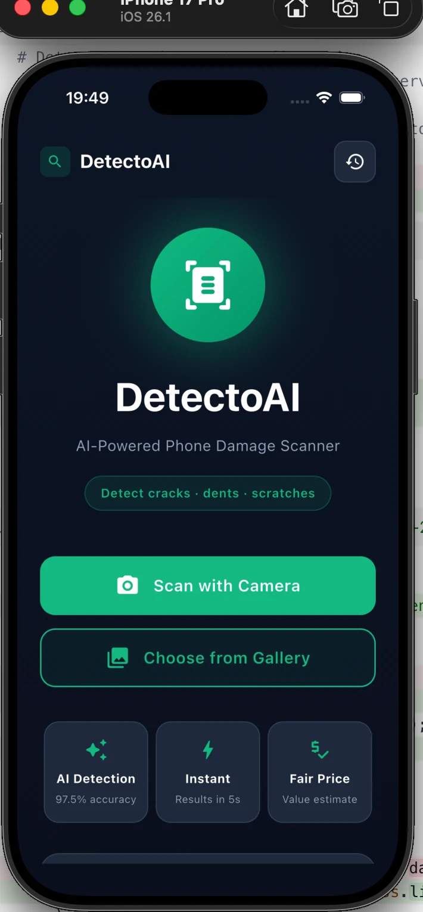
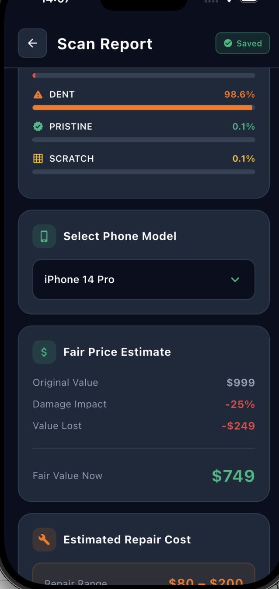
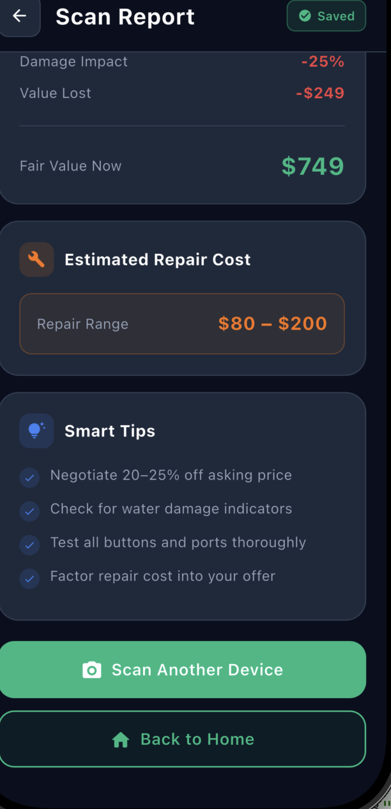

# DetectoAI

**AI-Powered Phone Damage Scanner**

DetectoAI uses a YOLOv8 classification model to detect phone damage from a photo — cracks, dents, scratches, or pristine condition — and instantly gives you a fair resale value and repair cost estimate.

---

## Screenshots

<p float="left">
  
  
  
</p>

---

## Features

- **AI Damage Detection** — YOLOv8 model trained on 4 classes: crack, dent, scratch, pristine
- **Confidence Threshold** — rejects unclear or non-phone images (< 55% confidence)
- **Fair Price Estimate** — resale value calculated per phone model and damage type
- **Dynamic Repair Costs** — repair ranges scale with the phone's market value
- **Scan History** — every scan is saved locally; swipe to delete, tap to re-open
- **Dark Theme** — full dark UI with accent colors per damage type

---

## Tech Stack

| Layer | Technology |
|-------|-----------|
| Mobile app | Flutter (Dart) |
| Backend API | FastAPI (Python) |
| AI Model | YOLOv8 classification (`ultralytics`) |
| Image handling | PIL / Pillow |
| Local storage | `shared_preferences` |

---

## Running Locally

### 1. Backend

```bash
cd ml/backend
source ../../.venv/bin/activate
python3 -m uvicorn main:app --host 0.0.0.0 --port 8000
```

### 2. Flutter App (iOS Simulator)

```bash
cd app
flutter run
```

### 3. Flutter App (Real iPhone)

Find your Mac's local IP:
```bash
ipconfig getifaddr en0
```

Update `app/.env`:
```
API_BASE_URL=http://<your-mac-ip>:8000
```

Then run:
```bash
cd app
flutter run -d <your-iphone-device-id>
```

---

## Model

The YOLOv8 classification model is located at `ml/results/detectoai_cls_best.pt`.

**Classes:** `crack` · `dent` · `scratch` · `pristine`

---

## Project Structure

```
DetectoAI/
├── app/                    # Flutter mobile app
│   ├── lib/
│   │   ├── screens/        # HomeScreen, AnalysisScreen, ResultsScreen, HistoryScreen
│   │   ├── services/       # ApiService, HistoryService, ResaleCalculator
│   │   └── models/         # ScanResult
│   └── .env                # API_BASE_URL config
├── ml/
│   ├── backend/            # FastAPI server (main.py)
│   └── results/            # Trained YOLO model (.pt)
└── screenshots/
```
